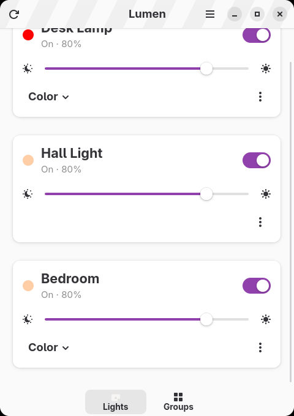

<p align="center">
  
</p>

<h1 align="center">Lumen</h1>

<p align="center">Control Yeelight lights on your local network.</p>

<p align="center">
  <a href="https://github.com/bruno-srio/lumen/actions/workflows/ci.yml"></a>
  <a href="LICENSE"></a>
  <a href="https://github.com/bruno-srio/lumen/releases/latest"></a>
</p>

<p align="center">
  
</p>

Lumen is a native GNOME application. It finds Yeelight lights on the LAN and lets you turn them on or off, set the brightness, pick a color or a white temperature, save colors, and control a group together. It does not use a Yeelight account, a cloud API, or an internet connection.

Yeelight is a trademark of its owner. Lumen is an independent project and is not affiliated with Yeelight.

## Install

<a href="https://flathub.org/apps/io.github.bruno_srio.Lumen"></a>

## What it does

- Discovers lights and reconnects to ones it has seen before, or adds one by IP address.
- Remembers the names you choose, even when an IP address changes. A name can also be stored on the light.
- Shows only the controls each bulb actually supports, including color temperature.
- Groups lights so one switch, slider, or color applies to the whole room.
- Saves colors, runs candle, sunrise, and color-loop effects, and sets a sleep timer.
- Turns every reachable light on or off at once, including from a system shortcut while the window is closed.
- Can keep running after the window is closed.
- Dims a card when a light goes away, and reconnects when it returns.
- Slows slider changes so a drag does not hit the bulb's command limit.

## Enable LAN Control

Each bulb has LAN Control (sometimes called Developer Mode) turned off until you enable it in the Yeelight mobile app, in that light's settings. The computer and the lights must be on the same network. The steps are in [docs/LAN-CONTROL.md](docs/LAN-CONTROL.md).

## Building

Contributors with GTK 4.20 or newer and libadwaita 1.8 or newer:

```sh
cargo test --workspace
cargo run -p lumen
```

On Fedora, those libraries can stay inside the `yeelight-dev` Toolbox. `./scripts/dev.sh` uses that container when the host does not have them. After a Fedora upgrade, run `./scripts/dev.sh bootstrap` to recreate it. Details are in [docs/DEVELOPMENT.md](docs/DEVELOPMENT.md).

## Build from source

Fedora, or another distribution with GTK 4.20, libadwaita 1.8, and Rust 1.87:

```sh
sudo dnf install rust cargo clippy rustfmt gtk4-devel libadwaita-devel \
  meson blueprint-compiler desktop-file-utils appstream gettext gcc pkgconf
meson setup _build -Dprofile=development
meson compile -C _build
_build/src/lumen
```

The development build uses the application id `io.github.bruno_srio.Lumen.Devel`, so its settings stay separate. To try the app without bulbs, run `cargo run -p yeelight-sim`. See [CONTRIBUTING.md](CONTRIBUTING.md) and [docs/TESTING.md](docs/TESTING.md).

## Support the project

If Lumen is useful, you can support development:

- [GitHub Sponsors](https://github.com/sponsors/bruno-srio)
- [Ko-fi](https://ko-fi.com/bruno-srio)

## More

- [Security](docs/SECURITY.md) — the Yeelight protocol is not encrypted.
- [Packaging](docs/PACKAGING.md) — Flatpak and Flathub.
- [Protocol notes](docs/PROTOCOL-NOTES.md)
