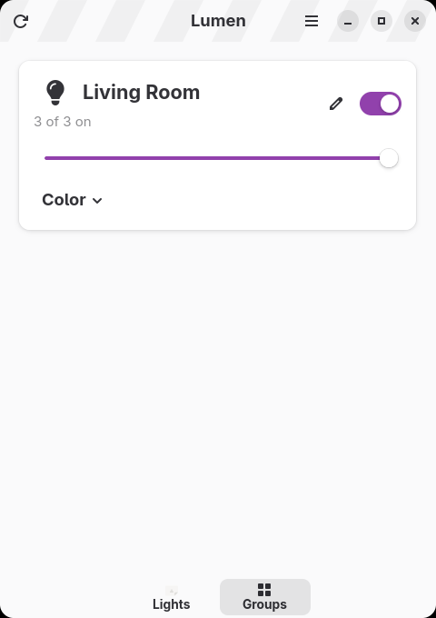
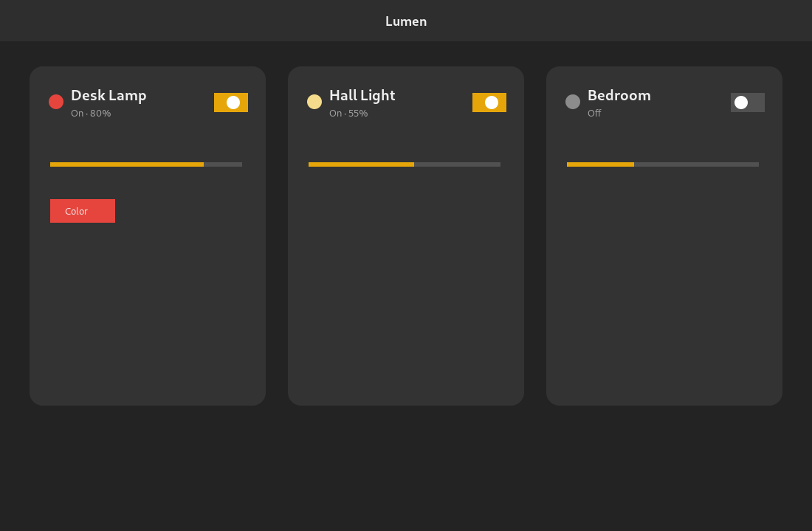

<p align="center">
  
</p>

<h1 align="center">Lumen</h1>

<p align="center">Control Yeelight lights on your local network.</p>

<p align="center">
  <a href="https://github.com/bruno-srio/lumen/actions/workflows/ci.yml"></a>
  <a href="LICENSE"></a>
  <a href="https://github.com/bruno-srio/lumen/releases/latest"></a>
</p>

<p align="center">
  
</p>

<p align="center">
  
</p>

<p align="center">
  
</p>

Lumen is a GNOME app for Yeelight lights on the local network. You can turn them on or off, set the brightness, pick a color or a white temperature, save colors, and control a group together. It does not use a Yeelight account, a cloud API, or an internet connection.

The lights speak Yeelight's LAN protocol: a UDP search on the local network, then plain-text commands over TCP. There is no encryption. [Security](docs/SECURITY.md) says what that means. Each bulb also needs LAN Control turned on in the Yeelight phone app. The steps are in [Enable LAN Control](docs/LAN-CONTROL.md).

Yeelight is a trademark of its owner. Lumen is an independent project and is not affiliated with Yeelight.

## What it does

- Discovers lights and reconnects to ones it has seen before, or adds one by IP address.
- Remembers the names you choose, even when an IP address changes. A name can also be stored on the light.
- Shows only the controls each light supports, including color temperature. Each light's menu lists only those controls.
- Groups lights on their own page, with an icon for each group, so one switch, slider, or color applies to the whole room.
- Saves colors, runs candle, sunrise, and color-loop effects, and sets a sleep timer, including a custom duration.
- Turns every reachable light on or off at once, including from a system shortcut while the window is closed.
- Can keep running after the window is closed.
- Dims a card when a light goes away, and reconnects when it returns.
- Slows slider changes so a drag does not hit the bulb's command limit.

## Install

Flatpak bundles are on the [releases](https://github.com/bruno-srio/lumen/releases) page. Download `lumen-<version>.flatpak` and install it with:

```sh
flatpak install --user lumen-<version>.flatpak
```

You also need the GNOME 51 runtime. The bundle points at Flathub for that runtime. Lumen itself is not on Flathub.

## Building

If GTK 4.20 or newer and libadwaita 1.8 or newer are installed:

```sh
cargo test --workspace
cargo run -p lumen
```

`./scripts/lumen` is the command I use. It calls `./scripts/dev.sh`, which runs Cargo on the host when `pkg-config` can see those libraries, and otherwise in a Toolbox. You do not need that container if the libraries are already on your machine. Setup notes are in [docs/DEVELOPMENT.md](docs/DEVELOPMENT.md).

To try the app without bulbs, run `cargo run -p yeelight-sim` in another terminal.

## Support the project

If Lumen is useful, you can [sponsor the work on GitHub](https://github.com/sponsors/bruno-srio).

Ko-fi, donations later.

## More

- [Contributing](CONTRIBUTING.md)
- [Security](docs/SECURITY.md)
- [Packaging](docs/PACKAGING.md)
- [Protocol notes](docs/PROTOCOL-NOTES.md)
- [How this project is written](docs/AI_USAGE.md)
